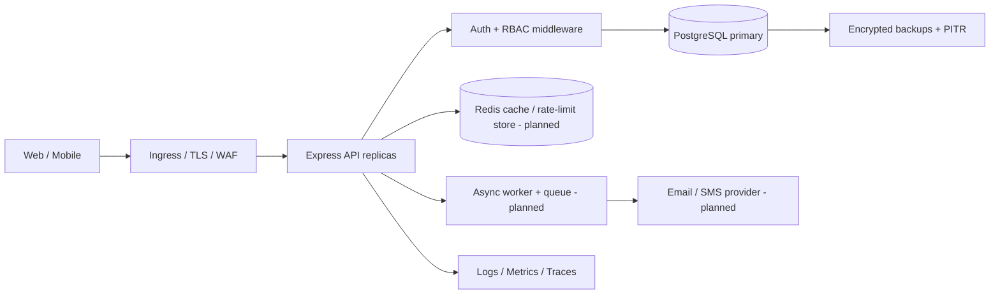
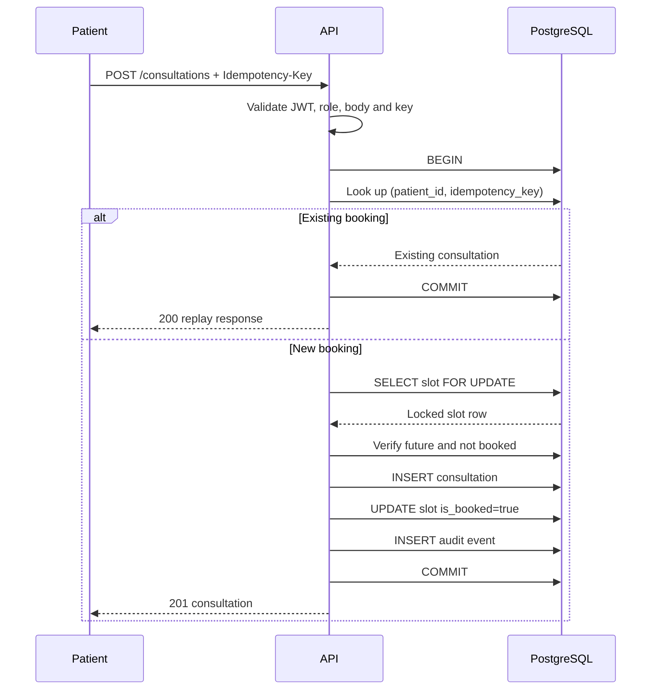
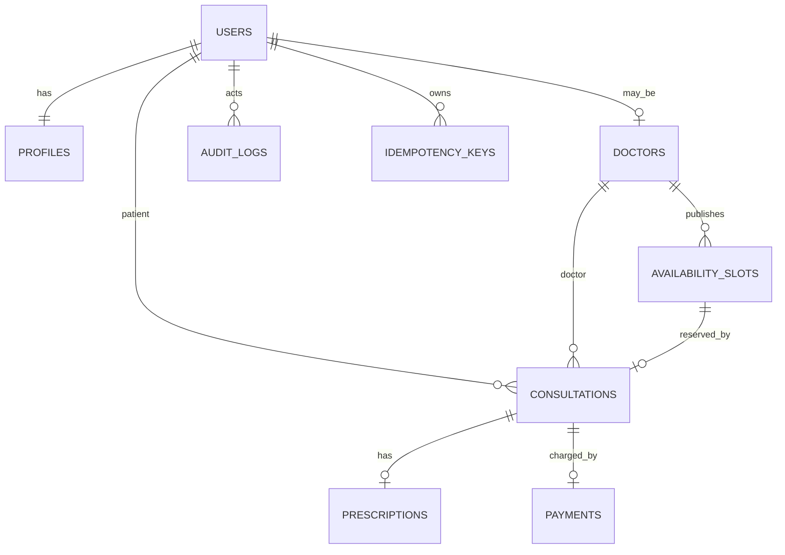

# Architecture and Data Flow

## 1. Goals and assumptions

The assignment specifies 100,000 daily consultations, p95 read latency below 200 ms, p95 write latency below 500 ms, 99.95% availability, encryption, MFA, RBAC, metrics/logs/traces, and containerized CI/CD. The daily average is about 1.16 consultations/second; capacity planning must use peak traffic and read amplification, not the average alone. The implementation is a modular monolith to keep the initial transaction boundaries simple. Modules can be extracted after traffic and team ownership justify the operational cost.

## 2. High-level architecture

The repository currently implements the API, PostgreSQL schema, HTTP metrics, structured logs, and health endpoints. Redis caching, distributed rate-limit storage, async queue, tracing exporter, ingress/WAF, and backup automation are explicit deployment extensions rather than falsely claimed as working components.

## 3. Core request flows

### Registration and login

1. Validate request schema and normalize email.
2. Hash password with bcrypt; persist only the hash.
3. Insert user, profile, and audit record in a transaction.
4. Login compares the hash and issues a short-lived HS256 JWT with issuer/audience constraints. Authorization reads the role from the signed token. Production should add refresh-token rotation/revocation and MFA enrollment/challenge before marking accounts MFA-enabled.

### Booking sequence

The row lock serializes requests for a slot; the unique `consultations.slot_id` and unique `(patient_id, idempotency_key)` constraints provide final database-level protection. A production implementation should also persist the original request hash and replay the exact original response for every idempotency key; this starter returns the existing booking for same-patient key reuse.

## 4. ER model

Key indexes cover available doctor slots, patient history, doctor/status history, and recent audit events. `consultations.slot_id` is unique, ensuring a slot can only be booked once. Use UUID primary keys to avoid sequential ID disclosure and simplify distributed ID generation.

## 5. API and module boundaries

`src/routes/auth.js` owns identity endpoints; `doctors.js` owns doctor search and availability; `consultations.js` owns booking, status transitions, and prescriptions. Authentication and authorization are middleware; audit writes are centralized in `services/audit.js`; DB access uses a shared PostgreSQL pool. `openapi.yaml` describes the public API contract.

## 6. Consistency, retries, and sagas

- Booking is a single PostgreSQL transaction and must not be retried blindly after an ambiguous network failure unless the same idempotency key is reused.
- For transient database failures, retry only known transient SQLSTATEs (for example serialization failure `40001` or deadlock `40P01`), at most 3 attempts, exponential backoff with jitter (e.g. 50 ms, 150 ms, 350 ms), and a strict total deadline. The retry wrapper is a production follow-up, not currently implemented.
- Do not retry validation, authorization, uniqueness, or business-state errors.
- Payment and notification workflows should use a transactional outbox. A saga coordinates booking/payment/notification with idempotent consumers and compensating actions (cancel booking/refund payment). Do not hold a database transaction open while calling external services.
- State transitions are explicitly validated. Cancellation reopens a slot; production must define cutoff rules and reconcile concurrent rescheduling.

## 7. Scalability, caching, and partitioning

Start with indexed PostgreSQL and horizontal stateless API replicas. Cache only non-sensitive public doctor directory/search data with short TTL and explicit invalidation; do not cache prescriptions or identifiable patient records in shared caches. Redis is optional and not wired in this starter. Use a shared Redis-backed rate limiter when horizontally scaled.

At growth, use read replicas for safe read-heavy queries, connection pooling (PgBouncer), queue-based async work, and query/index monitoring. Partition high-volume `audit_logs` by month and retention policy; consider time-based partitioning for consultations only after measuring table/index size and query plans. Avoid premature sharding because booking needs transactional consistency. Keep slot and consultation data on the same transactional database partition until a deliberate distributed booking design exists.

## 8. Availability, recovery, and SLOs

99.95% availability allows about 21.6 minutes of downtime per 30-day month. Run multiple API replicas across availability zones behind health-checked ingress; use managed PostgreSQL with multi-zone failover, automated encrypted backups, point-in-time recovery, and documented restore drills. Proposed starting targets: RPO ≤ 5 minutes with WAL/PITR and RTO ≤ 60 minutes; these are goals to validate with the chosen cloud provider, not measured guarantees. Monitor error rate, p95/p99 latency, DB pool saturation, slow queries, booking conflict rate, queue lag, and backup age. Alert on SLO burn rates.
